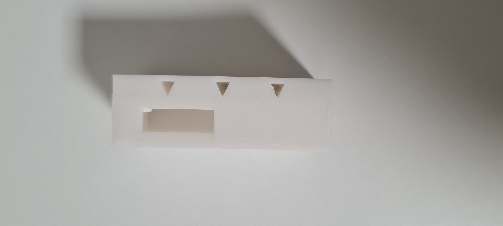
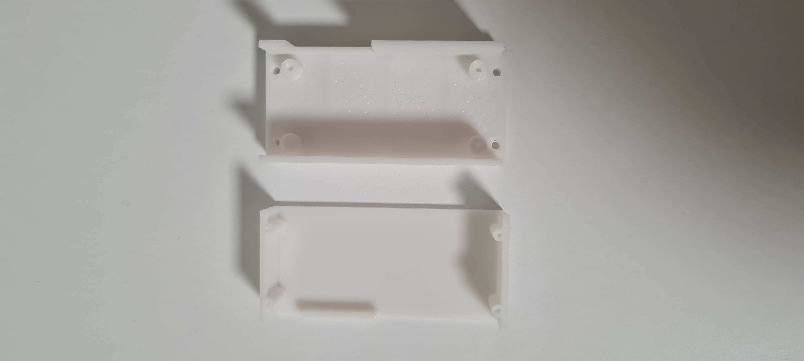
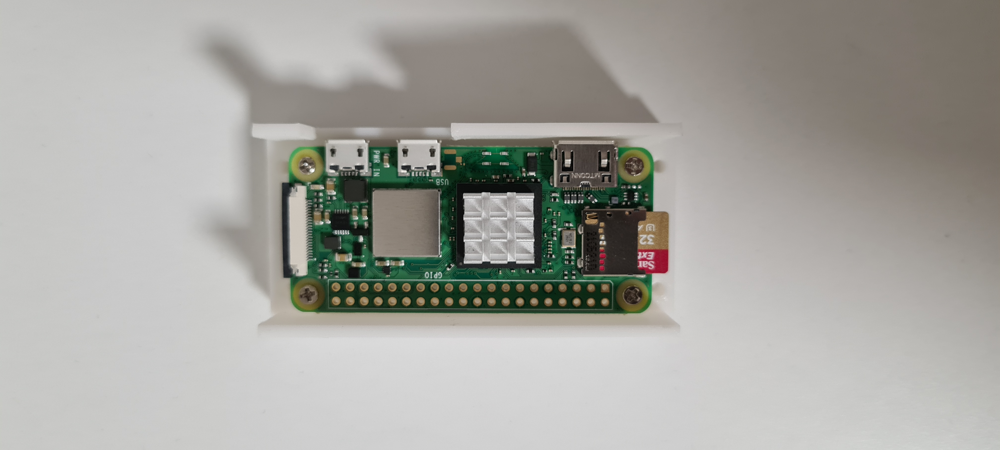
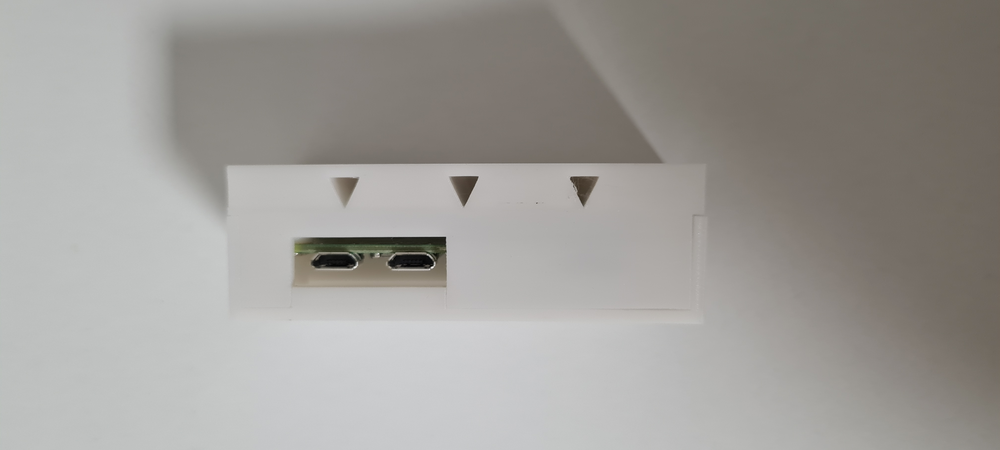
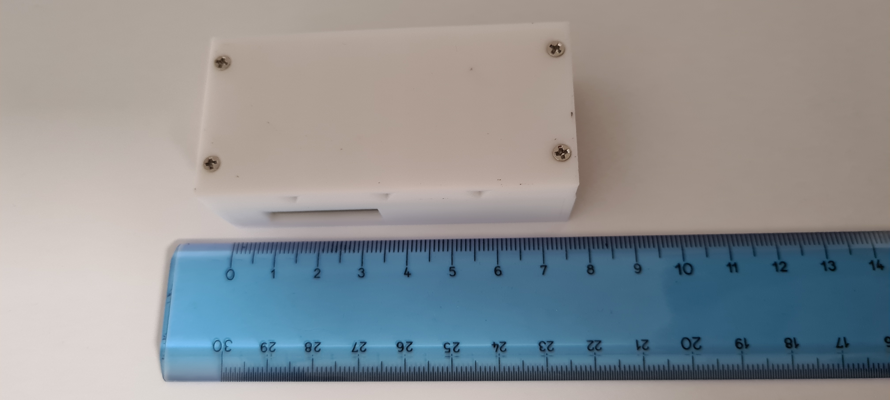
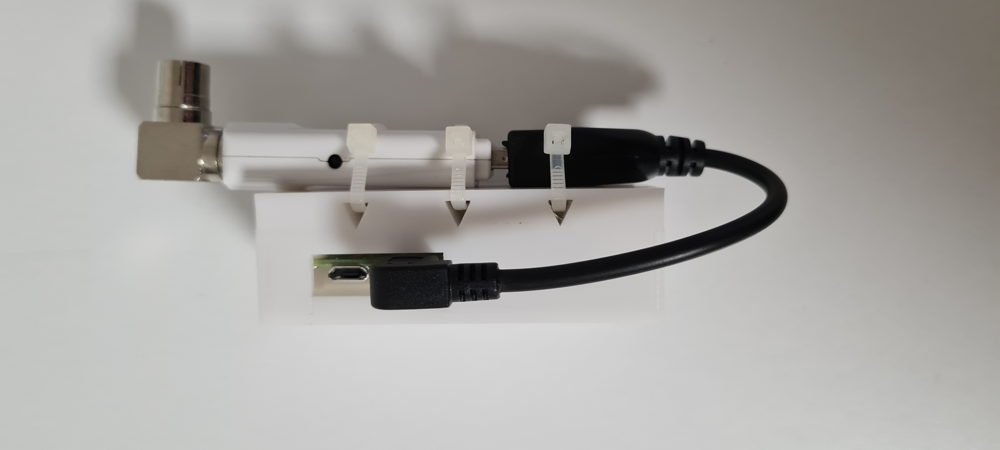
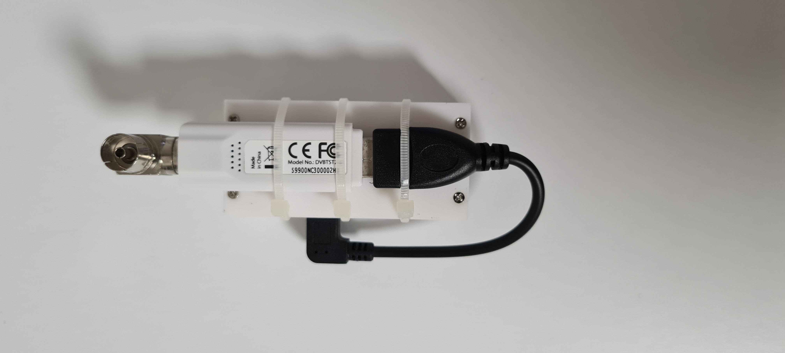
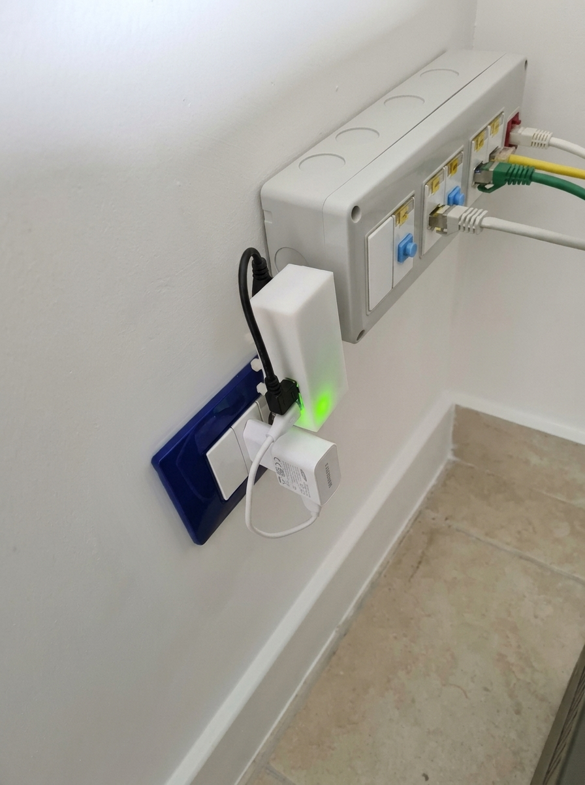

# Tvheadend Pi Zero 2W & DVB-T2 Tuner Case (WireGuard Network Hub)

A tiny, support-free 3D-printed case designed to house a Raspberry Pi Zero 2 W and a USB DVB-T2 TV Tuner. This compact hardware setup streams live TV (including 1080p and experimental 4K channels) to smartphones and remote clients anywhere in the world over a secure, self-hosted encrypted network.

### 📸 Project Gallery
Here is the final hardware setup and the clean wall installation:

  
  
  
  
  
  
  
  

### 🛠️ Hardware & Software Architecture Features

* **3D Printing Optimization:** The enclosure features three **triangular-section** passthrough holes to secure the USB TV tuner with zip ties. This specific geometry allows the internal overhangs to be printed cleanly without requiring any removable support material.
* **Hub-and-Spoke Network Architecture:** The home-based Raspberry Pi acts as a *Spoke* (client) inside an encrypted **WireGuard** tunnel hosted on a cheap public VPS (Hub). This design completely bypasses carrier-grade NAT (CGNAT) without opening any vulnerable ports on the home router.
* **Streaming Efficiency:** Since modern broadcasting utilizes the **HEVC (H.265)** codec, a 1080p stream requires very low bandwidth (around 2.5 - 4 Mbps per stream). Video decoding is handled entirely by the client's smartphone hardware (using apps like *Tvhclient* and *VLC* as the player), keeping the Pi Zero 2 W CPU cool and free from graphical overhead.
* **Multi-Stream & Storage:** A single USB tuner allows multiple users to watch up to 4 different channels simultaneously, provided they belong to the same transponder/multiplex (MUX). Scheduled recordings managed via **Tvheadend** are saved directly onto the local home NAS, preventing MicroSD card degradation and wear.

### 📦 Repository Contents

* `rpiz2w_b.stl` — Bottom part of the enclosure with board standoffs.
* `rpiz2w_t.stl` — Top cover.
* `README.md` — This documentation.
